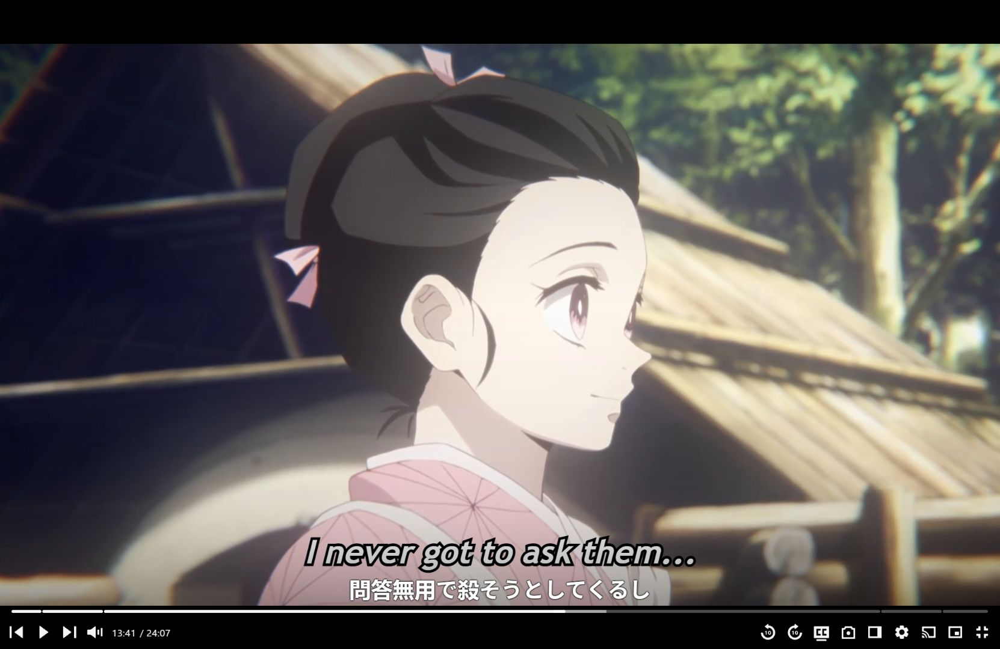

# SubtitlePlayer review — 18 October 2026

The prepared Demon Slayer S01E05 stream needs **two subtitle offsets**:
**+1.000 seconds for cues 1–136**, then **−7.216 seconds for cues 137–265**.
The approximately 8.2-second change is present in the subtitle/reference timing,
independently of the desktop clock. A single global offset cannot correct it.

I tested the running desktop app and the prepared Chrome page, inspected the
playback, navigation, OCR, external-player, configuration, renderer, cue snapshot,
startup, search/cache, settings and Anki integration paths, and ran the model
tests. This is a focused functional and architecture review, not a claim that
every code path or integration has been exercised.

## Evidence and deliverables

- [Retimed Japanese subtitles](Kimetsu.S01E05.miruro-retimed.ja.srt): separate output for this specific stream. Use with a **0-second additional offset** and a clock synchronized to the video.
- [Automatic fit](alignment.json): per-window estimates, two segments and per-cue corrections.
- [23 dialogue anchors](validation-anchors.json): comparison against the source English caption track.
- [Isolated test output](pytest-isolated.txt) and [JUnit results](pytest-isolated.xml).
- [Standalone experimental aligner](../../experiments/probe_subtitle_alignment.py) and [four ground-truth tests](../../tests/test_subtitle_alignment_probe.py).
- [Original Japanese input](source-jp.srt) and [source English reference](source-en.vtt), saved so the experiment does not depend on the app's temporary cache.

All 265 cues retain their text and duration, with ordered, valid timestamps.
For 23 manually selected corresponding dialogue starts, the median absolute
residual after retiming is **0.041 seconds**, and the largest is **0.208 seconds**.
These are caption-to-caption measurements. Different translation segmentation
can account for small residuals. They do not constitute an independent
audio-onset measurement or prove that every cue is perfectly timed.

## Why the offset changes

The input is `[Crunchyroll Retime] Kimetsu no Yaiba - S01E05.ja.srt`.
The prepared page is Miruro episode 5, using the embedded `strm.cx` player.
Its video duration was 1447.829333 seconds, playback rate 1.0. I read the
HTML video clock directly and compared the actual English VTT used by the page
against the local Japanese file.

Offset convention: **video time = original subtitle time + offset**.
A positive offset displays subtitles later; a negative offset displays them earlier.

| Cue | Japanese file start | Corresponding source caption start | Required offset |
|---|---:|---:|---:|
| 2 | 00:03.462 | 00:04.462 | +1.000 s |
| 39 | 06:16.251 | 06:17.210 | +0.959 s |
| 134 | 12:58.487 | 12:59.487 | +1.000 s |
| 136 | 13:05.952 | 13:06.952 | +1.000 s |
| 139 | 13:32.145 | 13:24.970 | −7.175 s |
| 169 | 16:05.215 | 15:58.040 | −7.175 s |
| 197 | 18:08.296 | 18:01.038 | −7.258 s |
| 263 | 23:28.074 | 23:20.857 | −7.217 s |

The step is bracketed by confirmed dialogue near **13:09–13:25 in the source**.
The automatic fit assigns the second correction starting at cue 137, after
the long gap following cue 136. The exact edit frame is not established.
An intermission/eyecatch or other version difference is a plausible explanation;
that cause is an inference, while the timing step is measured. The stable
offset on either side is inconsistent with a simple, continuous frame-rate drift.

The initial Japanese text visible inside Chrome belongs to **asbplayer**,
identified by its DOM elements and extension frame. It is a separate renderer
from the desktop overlay. Its hidden UI also contained an offset label, so I
did not use that label as timing ground truth. The source English captions and
video clock provided an independent reference.



## Functional findings, in priority order

### 1. Make the video clock authoritative

**Confirmed:** starting/pausing the browser video and seeking its timeline did
not make the desktop clock follow it. The video moved from about 4:01 to 13:41;
SubtitlePlayer still showed 4:01 until I used OCR Read Now.

`controller/playback_controller.py:14` advances a separate `perf_counter` clock.
Its accounting is sensible; the existing spacebar and seek simulations reported
essentially zero arithmetic drift when both simulated players receive the same
events. This does not test real browser delivery, buffering or video seeking.

`app.py:24` leaves the sync-server import commented out, and
`controller/controller.py:2950` contains commented sync-loop code. The existing
server in `video_sync_server.py` is therefore not an active solution.

**Change:** a browser adapter should publish `currentTime`, `paused`,
`playbackRate`, `seeking`, `waiting`, `readyState`, duration, media identity,
sequence number and observation time. The app follows that state; its local
clock only interpolates between fresh observations while the video advances.
Freeze during buffering/seeks and show a disconnected state when observations
expire. Browser play/pause/scrub/speed/intro-skip then work without user timing input.

### 2. Separate clock synchronization from subtitle alignment

**Confirmed:** OCR Read Now correctly read **13:41 / 24:07**, updated the app to
821 seconds, and logged a duration of **771 ms**. The saved region works in
the tested layout. OCR cannot infer the two file offsets by reading a clock.

`controller/ocr_controller.py:267` sets the app time, while its five-second
live-sync path does not read the video's paused/buffering state. `on_ocr_sync_now`
starts the app timer even when the source could be paused. OCR should remain
a fallback, with visible success/failure, reading age and measured latency.
Timestamp the captured image and account for processing time if playback is running.

**Change:** introduce a separate alignment map from original subtitle times to
video times, including multiple segments and an optional rate correction. Use
that same mapping for rendering, previous/next cue navigation, looping and Anki
media capture. Preserve original times in cue metadata for debugging.

### 3. Correct the manual offset interaction

In `view/settings_ui.py:1415`, `_apply_offset_change` defaults to moving the
slider by the offset delta, then commits that slider time. A small isolated
reproduction showed that changing offset 0 → +7 at app time 100 moves app time
to 107. Since rendering uses `current_time - offset`, the effective subtitle
time remains 100. This preserves the current cue instead of letting the user
immediately see the requested timing correction against a stationary video.

The programmatic `_set_runtime_offset` already uses `adjust_current=False`.
Use that behavior for ordinary user timing corrections too. Label controls
**Subtitles earlier** / **Subtitles later**, show the signed value and explain
the direction. Keep the displayed video time fixed when changing subtitle delay.

Offsets are currently saved by anime name (`controller/controller.py:435`).
Store alignment by episode + subtitle hash + source/version identity instead.
Different episodes and streams can require different cuts; one show-wide value
will transfer the wrong correction.

### 4. Avoid speed and seek mismatches

The checked-in defaults have `FAST_FORWARD_DISABLED=false` and
`FAST_FORWARD_SPEED=1.5` (`config.json:44`). The playback loop multiplies elapsed
time by that speed. A fresh profile can therefore run the subtitle clock at
1.5× while a video remains at 1×. **Your current local profile disables this
and uses 1.0**, so it does not explain the measured midpoint step.

The app's skip value is 5 seconds; this player exposes 10-second rewind/forward
controls and a 10-second timeline key step. A shared key is not proof of equal
seeks. The existing simulation with app skip 5 and video skip 10 accumulated
100 seconds of mismatch after 20 forward actions. This is a code-level risk;
I did not establish the physical key handling of every installed extension.

**Change:** normal speed should default to 1.0. In connected mode, send explicit
seek/play/pause requests to the selected media and confirm the resulting state,
instead of assuming a window hotkey was consumed. The current
`ExternalVideoCommandService` explicitly reports delivery, not video state.

### 5. Reduce competing overlays and hidden controls

The first scene had overlapping English and Japanese captions near the bottom.
The browser also had asbplayer captions, separate from the desktop overlay.
The compact desktop root showed episode, Set to, Offset, Skip and a timeline,
but playback controls live in another floating window. There was no visible
connection indicator explaining why the video and app could differ.

Provide a small persistent bar with **connected video title**, **Play/Pause**,
**Previous/Next sentence**, **Repeat sentence**, **Sync status** and **Settings**.
Offer one-click Japanese-only and bilingual layouts with distinct vertical
positions. Choose which renderer owns Japanese captions so duplicate layers
do not compete. Make dragging available through a visible handle on hover.
Keep the transcript scrollable/searchable, with the active cue highlighted and
single-click seek, rather than making a whole-episode slider the main precise tool.

Advanced Settings opens correctly, and its search is helpful, but the General
tab mixes common visual options with prefetch timings, worker counts and other
implementation choices. Move those to Advanced. Rename **M1** to an explicit
shortcut-mode label, **Set to** to **Go to time**, and **Stop** to **Pause**.
Expose a short connection/setup flow and a few visible shortcuts before the
full keyboard/voice customization screens.

## Automatic alignment without manual offsets

The standalone prototype compares subtitle start/end boundary patterns in
two-minute windows, finds repeated offset clusters, and uses a penalized
sequence fit to avoid spurious changes. It ignores text and language.
It automatically recovered **+1.000 / −7.216 seconds** and the split between
cues 136 and 137 for this episode. No manually chosen anchors were given to
the fitter. The dialogue anchors were used to validate its output separately.

This proves a reference-caption approach is feasible here. It is deliberately
an **offline experiment**, not integrated into the running app. It requires a
correctly timed reference track, searches shifts within ±30 seconds, does not
fit frame-rate changes, and can be fooled by repetitive/sparse timing patterns.
Refusing sparse evidence is covered by a test, but it is not a calibrated
confidence detector. Production should use an established aligner plus
multi-window validation and expose uncertain matches rather than silently guessing.

Recommended pipeline:

1. Find the active video and episode automatically; read its actual clock/state.
2. When a timed source caption track is available, align downloaded Japanese
   subtitles to its activity pattern. Translation is unnecessary.
3. Prefer **alass** for cuts and frame-rate differences. It supports reference
   subtitles in different languages and explicitly handles splits. Its documented
   command is `alass reference.srt incorrect.srt output.srt`.
4. If no timed captions exist, align against accessible video/audio using speech
   activity; ffsubsync is another established option. Audio/DRM access and anime
   music/effects can limit this path. Speech recognition is an optional later
   fallback, not necessary when the existing timed captions are sufficient.
5. Cache the resulting piecewise map by episode, source identity and subtitle
   hash. Revalidate after a server/version change. Apply the map to every consumer.

See [alass documentation](https://github.com/kaegi/alass) and
[ffsubsync reference types](https://ffsubsync.readthedocs.io/en/latest/reference_types.html).
Those tools were researched, not installed or executed during this review.

## Existing integration options

| Approach | Fit for this project | Tradeoff |
|---|---|---|
| Keep Python features; add browser state + alignment adapters | Best way to retain custom ruby, voice and annotation behavior | Requires a maintained extension/bridge |
| Use asbplayer as browser playback/mining frontend | It is already present on the prepared page | Custom learning features may remain in a Python companion |
| Use mpv and its JSON IPC for accessible local video/streams | Reliable playback observations, exact seek, speed and subtitle control | Changes the viewing workflow; protected/browser-only sources may not transfer |
| Embed a media engine in a desktop app | One clock and one renderer | Largest rewrite; unnecessary as a first step |

asbplayer now documents an external API with bound-media discovery, subtitle
retrieval, exact timestamp seeking and mining to a specified Anki note ID.
That is a promising replacement for focus-sensitive capture hotkeys and
"last card" assumptions. It requires a compatible installed extension version
and its companion WebSocket server; I did not verify that your installed
version/server supports it. Its documented external API does not by itself
establish a continuous playback-state subscription.

Sources: [asbplayer external API](https://docs.asbplayer.dev/docs/reference/external-api/),
[mpv JSON IPC](https://mpv.io/manual/stable/#json-ipc).

The existing `dev/experiments/video_sync_extension/content.js` is a useful
starting point, but direct content-script `fetch` to the Flask server is subject
to cross-origin rules. The server has no CORS handling and the extension has no
background service-worker relay. Route messages through an extension service
worker with narrowly scoped loopback host access, or use native messaging.
Chrome documents that content scripts remain subject to the page's cross-origin
rules even when extension host permissions exist. Also add media selection,
state/freshness handling, validation and request ordering; one shared
`latest_time` variable is insufficient for multiple frames/videos.
See [Chrome cross-origin request guidance](https://developer.chrome.com/docs/extensions/develop/concepts/network-requests).

## Tests and code-maintenance findings

The first model-suite run used the repository working directory and loaded
personal `config.local.json`: **405 passed, 41 failed**. The two subtitle smoke
tests instantiate a real SubtitleManager with `ConfigManager("config.json")`
(`dev/tests/model/test_subtitle_manager.py:630`). Because the personal cleanup
setting was enabled, pytest registered the app's `atexit` cache deletion and
removed the shared temporary cache. I restored the observed prefetched episode
files 3–7 from the saved source map. Further suite testing used a separate
temporary working directory, synthetic local SRT and cleanup disabled.

The isolated baseline is **408 passed, 38 failed**. The three removed failures
were Anki tag assertions affected by the personal anime setting. Of the remaining
failures, nine encounter a renderer fake that lacks the new `cue_snapshot`
argument; other test doubles lack `line_segments`, `on_complete`, settings,
config or shortcut constants. Voice tests still expect `add_card_capture`.
These are not evidence of 38 independently confirmed runtime defects.
Behavioral mismatches, including duplicate queued seek actions, still require
triage with realistic fixtures.

Four new experiment tests pass: constant offset with jitter, a midpoint cut
without anchors, refusal on sparse evidence, and VTT cue-setting parsing.
Both new Python files also pass built-in syntax compilation. Flake8 was not
installed in this environment. No attempt was made to repair all pre-existing
test failures as part of this review.

Prioritize fixture isolation and contract updates before large refactoring.
The existing immutable CueSnapshot and main-thread dispatcher are useful
foundations. Use a typed playback state, a separate alignment map and a small
player-adapter interface instead of adding more responsibilities to proxy
controllers. Later split SubtitleManager (~5965 lines) into loading/parsing,
search/episode selection, preparation/cache and geometry services.

## Reproduce the experiment

From the repository root in PowerShell:

```powershell
.venv\Scripts\python.exe dev/experiments/probe_subtitle_alignment.py `
  dev/reviews/subtitleplayer-2026-10-18/source-jp.srt `
  dev/reviews/subtitleplayer-2026-10-18/source-en.vtt `
  --json dev/reviews/subtitleplayer-2026-10-18/alignment.json `
  --output dev/reviews/subtitleplayer-2026-10-18/Kimetsu.S01E05.miruro-retimed.ja.srt

$env:PYTHONPATH='.;SubtitlePlayer'
.venv\Scripts\python.exe -m pytest dev/tests/test_subtitle_alignment_probe.py -q -p no:cacheprovider
```

No production application code was changed, no Anki cards were created, and the
running app was not restarted. Advanced Settings was closed after testing.
The app was returned to 241.213 seconds, offset 0, and the source video to
241.193890 seconds, paused at rate 1.0: both display **4:01**, as initially.
[Restored browser state](restored-video.png) is saved separately from the
midpoint mismatch screenshot, which intentionally shows the test scene.
